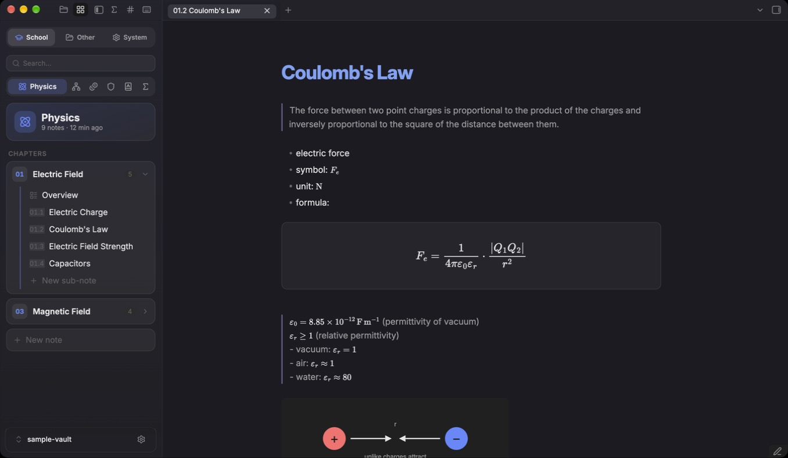
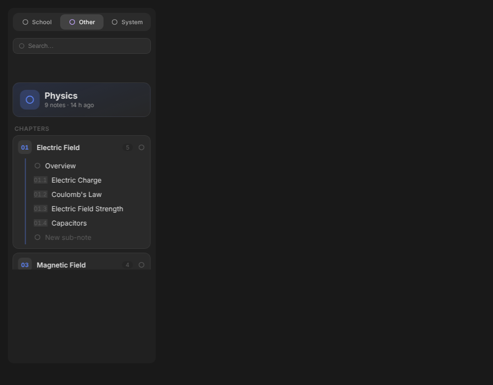

# Obsidian Sidebar Modes

A sidebar for [Obsidian](https://obsidian.md) with three modes, so you can switch between school notes and everything else with one click.



| Mode | What it does |
|---|---|
| **School** | Each folder is a subject. Chapters open as cards with numbered notes (`01.1`, `01.2` …). |
| **Other** | A small file manager with big folder tiles and pinned notes. |
| **System** | The same, for templates, attachments and archive. |

## Install

**With BRAT (easiest)**
1. Install the **BRAT** plugin from *Settings → Community plugins*.
2. Run the command **BRAT: Add a beta plugin**, paste `alechunder01/sidebar-modes`.
3. Enable **Sidebar Modes** in *Community plugins*.

**Manually**
1. Download `main.js`, `manifest.json` and `styles.css` from the [latest release](../../releases/latest).
2. Put them in `<your vault>/.obsidian/plugins/sidebar-modes/`.
3. Restart Obsidian and enable **Sidebar Modes** in *Community plugins*.

Want to try it first? Open the `sample-vault` folder as a vault.

## Use it

1. Click the grid icon in the left ribbon (or run **Open Sidebar Modes**).
2. Make folders like this:
   ```
   School/Physics/01 Electric Field/01.1 Charge.md
   Personal/
   System/
   ```
3. Pick a mode at the top, then a subject, then a chapter.
4. Right-click anything to pin, rename, move, or change its icon and colour. Drag and drop works too.

Everything else (folder names, mode names, icons, pop-up notes) is in *Settings → Sidebar Modes*.



## Help

- **Panel is empty?** Check that the School folder in settings exists.
- **Changes not showing?** Run **Reload app without saving**.
- Works on desktop and mobile. Sends no data anywhere.

## License

[MIT](LICENSE)
