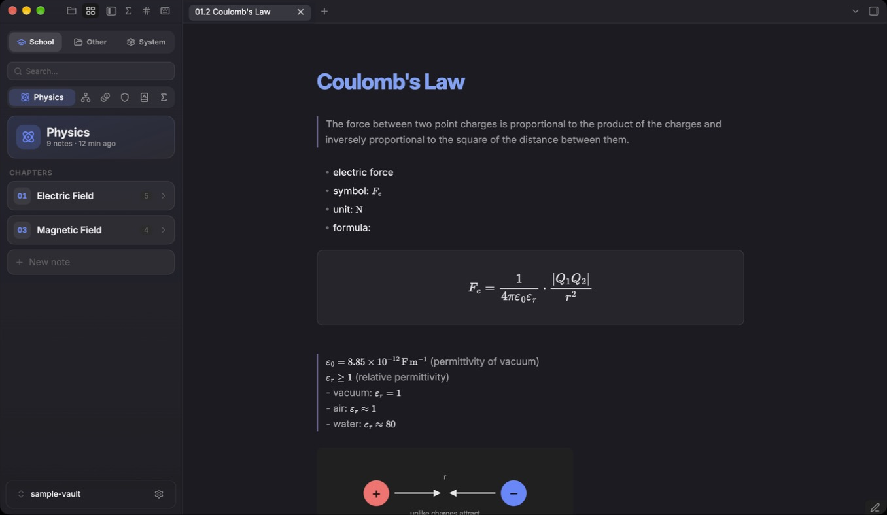
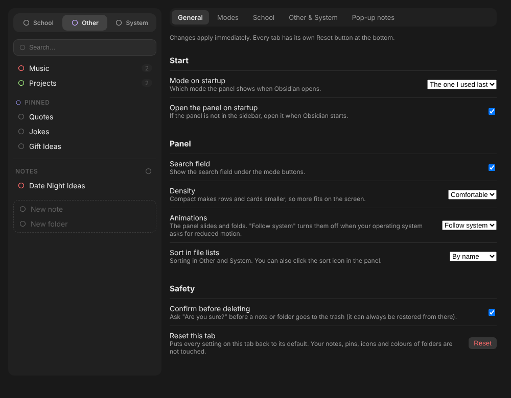
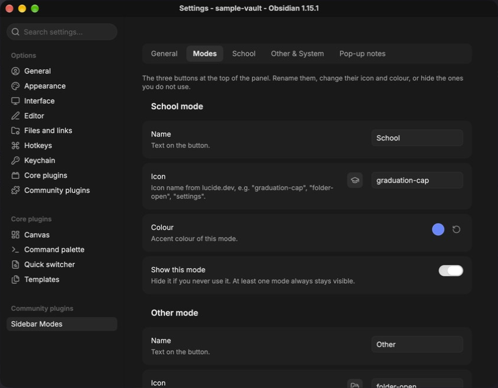

# Obsidian Sidebar Modes

A sidebar panel for [Obsidian](https://obsidian.md) that switches between **modes**. Each mode is a different way to browse your vault:

| Mode (default name) | What it shows |
|---|---|
| **School** | Every subfolder of your school folder is a subject (a tab). Inside, chapters are collapsible cards with numbered sub-notes (`03.1`, `03.2` …) and an automatic *Overview* note per chapter. |
| **Other** | A small file manager for everything else. Subfolders appear as big tiles, pinned notes sit underneath. |
| **System** | The same file manager, rooted in your system folder (templates, attachments, archive). |

Plain JavaScript, no build step, no dependencies, no network access. Works on desktop and mobile.



> Screenshots are from real Obsidian using the included `sample-vault` (dark theme with the optional CSS snippet, see below).

## Features

- Three modes with their own icons, names and colours. Every one can be hidden, renamed or re-pointed to another folder.
- Subject tabs, chapter cards (one open at a time), sub-notes with automatic numbering.
- Search that ignores capitals and diacritics. Enter opens the first result, Esc clears.
- Pinned notes, shown in the folder they live in.
- Drag & drop notes and folders onto folders, tiles, chapters, subject icons or the back arrow. Links keep working.
- Right-click menu: open, pin, icon & colour, rename, move, archive, duplicate, show in Finder, delete.
- Up to three pop-up notes (e.g. cheat sheets) in the top bar.
- Folder icons and colours with a picker (any [Lucide](https://lucide.dev) icon).
- A tabbed settings page where everything is customisable, each tab with its own Reset button.
- Follows your theme because it only uses Obsidian's CSS variables.


## Install

### Option A – BRAT (easiest, gets updates)

1. Install **Obsidian42 - BRAT** from *Settings → Community plugins → Browse*.
2. Command palette → **BRAT: Add a beta plugin for testing**.
3. Paste `alechunder01/sidebar-modes` and confirm.
4. Enable **Sidebar Modes** in *Settings → Community plugins*.

### Option B – Manual install from a release

1. Open the [latest release](../../releases/latest) and download `main.js`, `manifest.json` and `styles.css`.
2. In your vault create the folder `.obsidian/plugins/sidebar-modes/` and put the three files in it.
   (`.obsidian` is hidden: press `Cmd+Shift+.` in Finder on macOS, or enable *Show hidden items* in Explorer on Windows.)
3. Restart Obsidian, or run **Reload app without saving** from the command palette.
4. *Settings → Community plugins* → turn off *Restricted mode* if asked → enable **Sidebar Modes**.

### Option C – From source

```bash
git clone https://github.com/alechunder01/sidebar-modes.git
cd sidebar-modes
mkdir -p "/path/to/vault/.obsidian/plugins/sidebar-modes"
cp main.js manifest.json styles.css "/path/to/vault/.obsidian/plugins/sidebar-modes/"
```

There is nothing to compile: the files in the repo root are the plugin.

### Try it first

`sample-vault/` is a ready-made vault with sample notes. Open it via *Open folder as vault*, click *Turn on and reload* to enable community plugins, and the plugin is already installed.

### Optional: the look from the screenshots

The plugin only uses Obsidian's own CSS variables, so it follows your theme. The screenshots also use a small CSS snippet that tidies the editor (headings, callouts, tables). It is in `sample-vault/.obsidian/snippets/style.css`; to use it in your own vault copy it to `<your vault>/.obsidian/snippets/` and enable it in *Settings → Appearance → CSS snippets*. It is optional.

## Quick start

1. Click the **layout-grid icon** in the left ribbon, or run **Open Sidebar Modes** from the command palette. The panel opens in the right sidebar.
2. Create your folders:
   ```
   School/
     01 Physics/
       03 Magnetic Field/
         03.1 Basics.md
         03.2 Rules.md
   Personal/
   System/
     Templates/  Archive/  Attachments/
   ```
   The names `School`, `Personal`, `System` are the defaults and can be changed in settings.
3. Click a mode at the top. In School, pick a subject, open a chapter card, click a note.
4. Use **+ New sub-note** in a chapter; it creates the next number (e.g. `03.3 Title`).
5. Right-click anything for more actions.

## Using it

- **Search** – the field under the mode buttons filters note names in the current mode.
- **Back** – inside a folder a row shows `[back] [search] [sort]`; the arrow goes one level up.
- **Pins** – right-click → *Pin*. A pinned note appears in its own folder (in School: in its subject).
- **Move** – drag onto a destination, or right-click → *Move to…*.
- **Icon and colour** – right-click a folder or subject; pick a Lucide icon and a colour, or save your own colours.
- **Overview notes** – a chapter gets an *Overview* note listing its sub-notes under a `## Sub-notes` heading. Turn it off in settings.
- **Pop-up notes** – pick up to three notes in settings; buttons in the top bar open them as an overlay.


## Settings

*Settings → Sidebar Modes* has five tabs, each with its own **Reset** button (it never touches your notes):

| Tab | What you can change |
|---|---|
| General | Open on start, density (compact), motion, rows per folder, file sort |
| Modes | Show/hide each mode, names, icons, folders (with folder picker and live validation) |
| School | Chapter behaviour, overview notes, numbering, default look |
| Other & System | Archive folder, tiles, pinned section |
| Pop-up notes | Up to three notes with name, icon and note picker |





## FAQ and troubleshooting

**The panel is empty / "There are no subjects in the folder …"**
The School folder in settings does not exist or has no subfolders. Create it, or point the setting at the right folder.

**I changed files and nothing happened.**
Run **Reload app without saving**.

**I updated from "Subject Switcher".**
Rename the plugin folder to `sidebar-modes`, replace the three files, and change `subject-switcher` to `sidebar-modes` in `.obsidian/community-plugins.json`. Your `data.json` (pins, icons, settings) is kept, and the old panel is removed from your layout automatically.

**Does it work on mobile?** Yes (`isDesktopOnly` is false). "Show in Finder" only appears on desktop.

**Does it send data anywhere?** No. It only reads and moves files in your vault.

## Development

No build step. Edit `main.js` / `styles.css`, copy them to a vault's plugin folder, reload Obsidian. See [CONTRIBUTING.md](CONTRIBUTING.md).

## Releasing

Update `version` in `manifest.json` and `versions.json`, then:

```bash
git tag 1.0.0 && git push origin 1.0.0
```

The workflow in `.github/workflows/release.yml` publishes a release with the three plugin files.

## License

[MIT](LICENSE)
